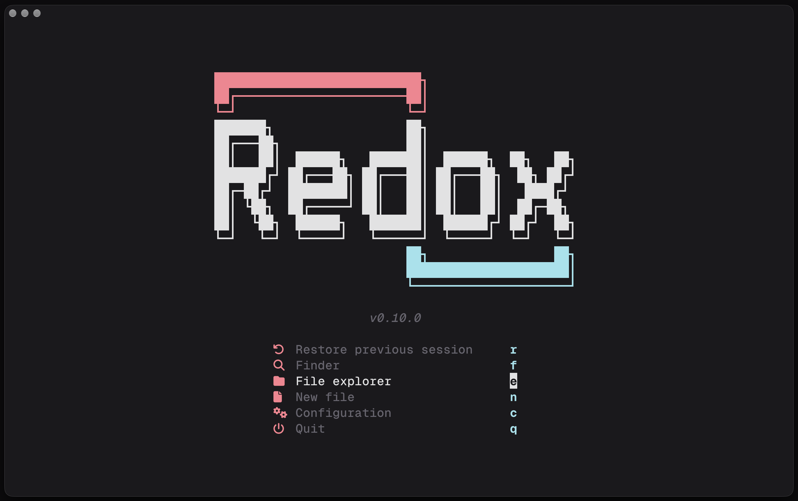
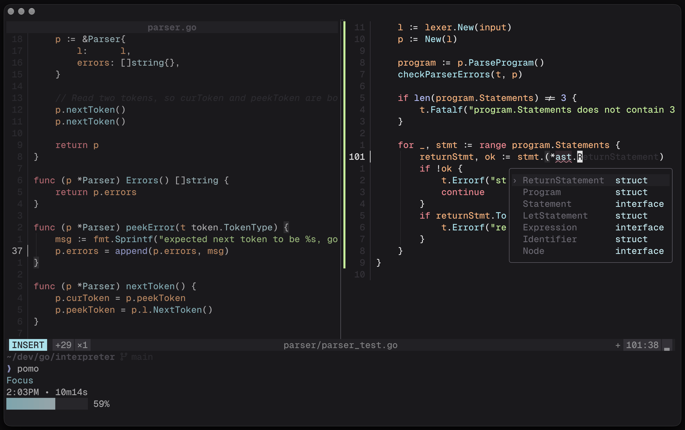

<h1 align="center">
    A terminal-based text editor that's tasteful by default.
</h1>

<p align="center">
    
</p>

---

<p align="center">
    Redox is a terminal-based, Vim-like text editor written in Rust. It was originally made for my university capstone project, but development is ongoing!
    <br><br>
    Redox is not associated with
    <a href="https://www.redox-os.org/">Redox OS</a>.
</p>

<p align="center">
    
</p>

## Why Redox?

Redox is essentially supposed to be an opinionated version of Neovim, built
from the ground up to be highly pleasant to use by default. It is made with my
personal preferences in mind, but remains highly configurable for your own
needs.
- Vim-style editing with visual modes, text objects, macros, and an undo tree.
- Tree-sitter syntax highlighting, smart indentation, and scope guides.
- Language server completions, diagnostics, formatting, and quick fixes.
- A fuzzy file finder, editable file explorer, and pinned files.
- Splits, an integrated terminal, and a dashboard for restoring sessions.
- Built-in defaults with configurable themes, keybindings, and zen mode.

## Install

Use a terminal with ANSI, raw-mode, and full colour support. Use a nerd font or
a terminal emulator with icons built-in for the optimal experience.

### Homebrew (macOS and Linux)

```sh
brew install jackderksen/tap/redox
```

### Cargo

With a Rust toolchain installed:

```sh
cargo install redox-editor --locked
```

The package is named `redox-editor`; the installed command is `redox`.
Cargo installs it into `~/.cargo/bin` by default, which must be on your `PATH`.

Prebuilt binaries are also available from
[GitHub releases](https://github.com/JackDerksen/redox/releases/latest).
See the [update guide](WIKI.md#updates) for upgrading and automatic update checks.

## Get started

```sh
redox             # Open the dashboard
redox README.md   # Edit a file
redox .           # Browse a directory
```

Redox uses Vim-style modes. Start with these defaults:

| Keys | Action |
| --- | --- |
| `i` / `Escape` | Enter insert mode / return to normal mode. |
| `h` / `j` / `k` / `l` or arrow keys | Move the cursor. |
| `:w` / `:w path` | Save the file / give a new buffer a filename. |
| `:q` / `:q!` | Quit when buffers are clean / discard unsaved changes and quit. |
| `<space><space>` | Find a file. |
| `<space>e` | Toggle the file explorer. |
| `/` | Search the current buffer. |
| `u` / `ctrl+r` | Undo / redo. |
| `:whichkey` | Show keybinding hints. |
| `:lsp list` | Install or enable language tools. |

Run `redox --help` for launch options. The [user guide](WIKI.md) covers the full
command and keybinding reference, language tools, splits, sessions, and more.

## Configure

Redox is designed to work without a configuration file. Run `:config` to open yours, and
`:config reload` to apply saved changes without restarting.

The default location is `~/.config/redox/config.toml`. You can override it with
`XDG_CONFIG_HOME`, `REDOX_CONFIG`, or `redox --config /path/to/config.toml`.
Use `redox --default-config` to try the built-in defaults for a session.

- [Example configuration](config.example.toml): a starting point with a complete theme.
- [Configuration reference](CONFIGURATION.md): path precedence, themes, keybindings, and every setting.
- [User guide](WIKI.md): commands, navigation, editing, and language tools.

## Development

From a cloned repository, build and install with a Rust toolchain:

```sh
cargo install --path . --locked
```

To run locally and check changes:

```sh
cargo run -p redox-editor -- ./README.md
cargo fmt --all --check
cargo clippy --workspace --all-targets --locked
cargo test --workspace --locked
```

Redox is a Cargo workspace built with MinUI. The root package provides the
`redox` binary; the libraries are also published separately.

| Crate | Responsibility |
| --- | --- |
| [redox-core](crates/redox-core/README.md) | UI-independent text buffers, motions, fuzzy matching, and sessions. |
| [redox-lsp](crates/redox-lsp/README.md) | Language-server transport, protocol handling, providers, and linters. |
| [redox-tui](crates/redox-tui/README.md) | Input, editor state, rendering, syntax highlighting, and terminal interaction. |

## Roadmap

Planned work, in no particular order:

- Project-wide symbol renaming.
- Searching text across files.
- More persistent project and session state.
- Broader fuzzy finder indexing and asynchronous refresh for large repositories.
- A fuzzy command palette.
- More Vim motions.

## Licence

[MIT](LICENSE).
